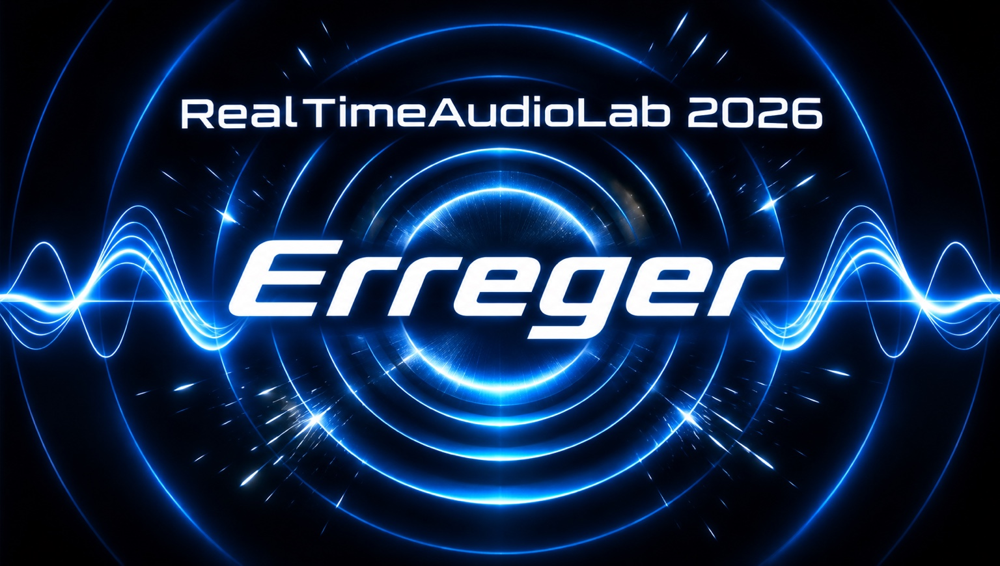

# GitHub repository setup

Suggested repository name (not assigned yet): `RTAL-Erreger`

## About / Short description

ESP32-S3 touchscreen virtual analog, wavetable and FM synthesizer, integrating selected InfeKt-FM1 code with RTAL real-time DSP and MIDI development.

## Topics

`esp32-s3` `synthesizer` `virtual-analog` `wavetable` `fm-synthesis` `dsp` `embedded-audio` `realtime-audio` `midi` `usb-midi` `i2s` `touchscreen` `arduino` `sound-design` `polyphonic-synthesizer` `realtimeaudiolab`

## Initial publication

Upload the contents of this directory to the root of the GitHub repository, keeping the relative `images/` and `docs/` paths. GitHub displays `README.md` automatically; the language link opens `README_DE.md`. Both READMEs use `images/erreger-startup.jpg` as the main project banner, followed by the enclosure preview. For the GitHub social preview, use the startup artwork as the preferred source for a separate 1280 × 640 composition if needed; the enclosure is an alternative. All seven images (five GUI images, one enclosure image and one startup artwork) are retained byte-for-byte without generated changes.

Do not choose a blanket firmware license or upload firmware and sound assets before completing the provenance audit in `CREDITS.md`. This is a teaser, not an installable release.

## Suggested announcement

RealTimeAudioLab Erreger is taking shape: a dedicated ESP32-S3 touchscreen synthesizer combining virtual analog, wavetable and FM sound design with a native RTAL real-time architecture. Built using selected code from j0kerpack's InfeKt-FM1 project, Erreger adds a new hardware target, native touch editing, a validated six-voice audio baseline and an evolving MIDI and preset workflow. Follow the development preview for technical progress, sound design and future hardware tests.
