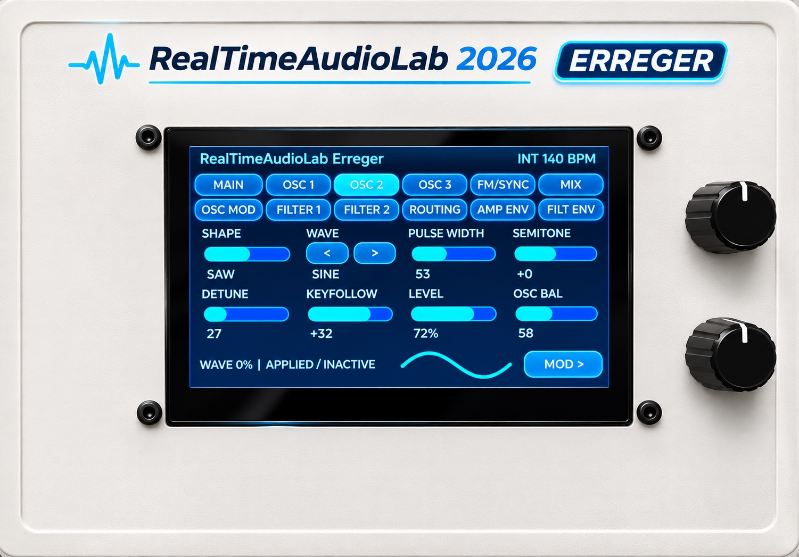
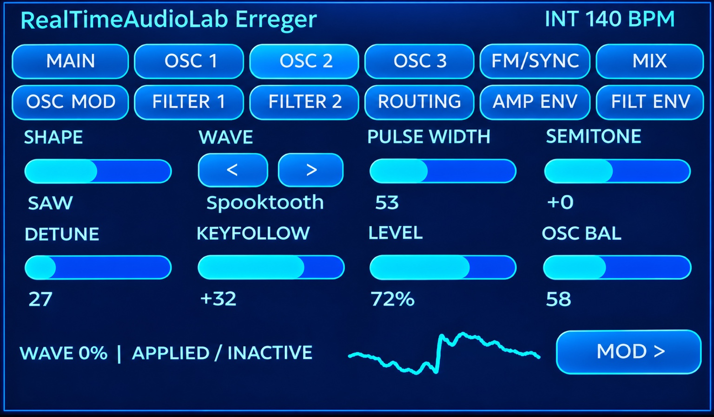
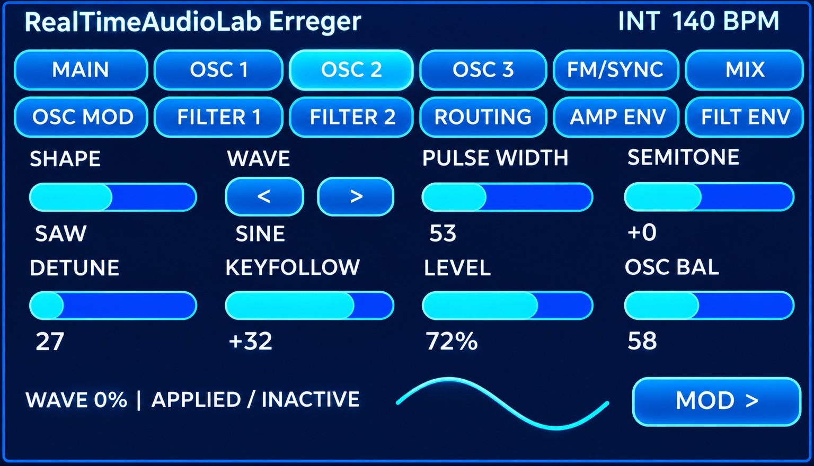
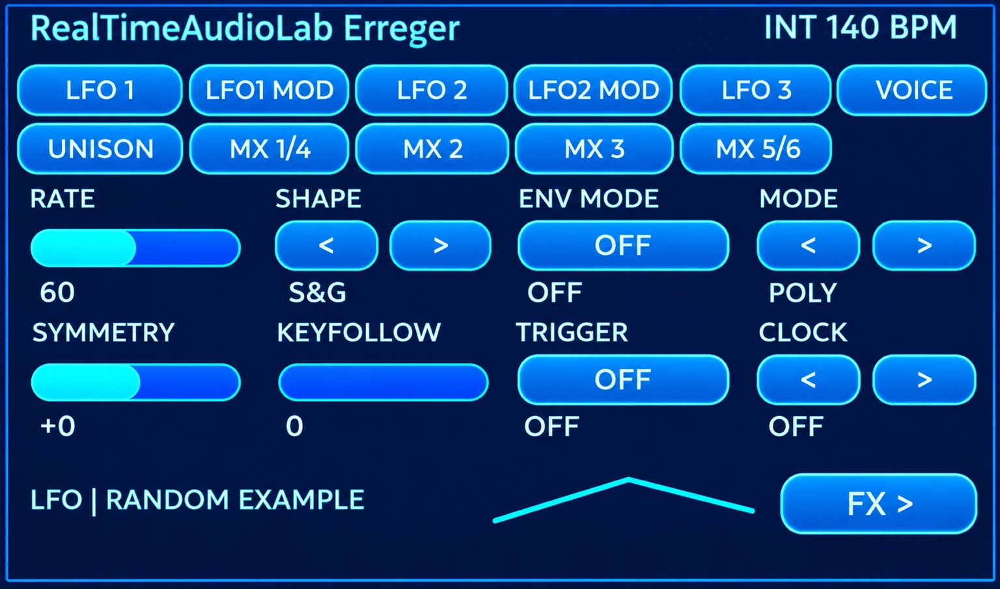
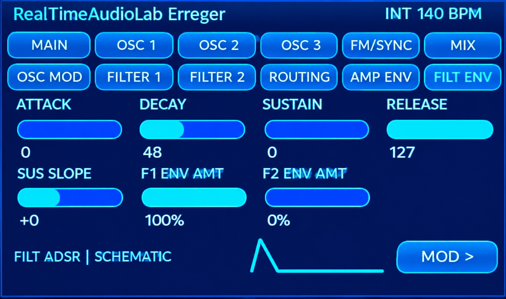
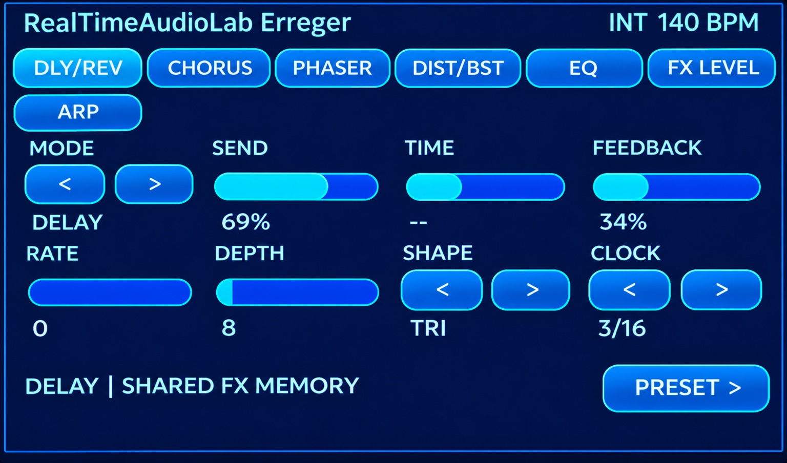
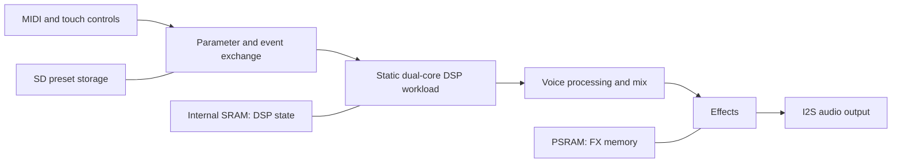

# RealTimeAudioLab Erreger

### Advanced Virtual Analog, Wavetable & FM Synthesizer for ESP32-S3

    

**A dedicated embedded instrument for evolving textures, aggressive digital timbres, expressive leads and deep modulation.**

[Deutsch](README_DE.md) · [Development & architecture](docs/DEVELOPMENT.md) · [Roadmap](docs/ROADMAP.md) · [Credits & licensing](CREDITS.md)

https://github.com/user-attachments/assets/b95629f8-60cc-425b-96e1-e71230a4c7c6

*Erreger startup artwork und sound demo — visual identity of the instrument.*

**Enclosure design preview**

*Enclosure design preview — the Erreger touchscreen interface in a white desktop housing. Final enclosure and physical control assignments are not yet specified.*

> **Development preview — November 2026.** Erreger is an independent ESP32-S3 port and extension integrating selected code from **InfeKt-FM1 by j0kerpack**. It is not the original FM-1 firmware, an official Access Virus product or a claim of exact sound or patch compatibility. No firmware is included in this teaser.

## From an existing synthesis engine to a dedicated instrument

The goal of Erreger is to bring a sophisticated digital synthesis architecture to an affordable, standalone touchscreen platform. Rather than reproduce the FM-1 user interface, RealTimeAudioLab is building a native instrument around a larger display, a real-time multicore audio architecture and an extensible performance workflow.

This project acknowledges j0kerpack's InfeKt-FM1 as its technical starting point. The original project combines virtual analog synthesis, complex modulation and digital effects; these synthesis concepts are not claimed as RTAL inventions. Erreger's contribution is the ESP32-S3 adaptation, engineering of the audio and UI runtime, native editing environment and platform-specific extensions.

## Sound design

| Section | Erreger editor / development scope |
| --- | --- |
| Oscillators | Three oscillator sections, waveform selection, shape, pulse width, coarse tuning, detune, keyfollow, level and balance |
| FM and sync | Dedicated modulation and synchronization controls for complex spectra |
| Filters | Two filter sections, dedicated routing controls and independent envelope amounts |
| Envelopes | Amplifier and filter ADSR editing, including sustain slope |
| Modulation | Three LFO sections, LFO modulation pages, matrix pages for six slots and voice/unison controls |
| Effects | Delay/reverb, chorus, phaser, distortion/boost, EQ and FX level pages |
| Performance | Arpeggiator, internal/external tempo, MIDI control and preset workflow |

These are visible editor features or project development scope; the table is not a claim that every combination has been hardware-qualified. Detailed compatibility with InfeKt-FM1 is not established.

## A native touchscreen editing environment

The instrument uses a 480 × 272 landscape touchscreen with a dark-blue and cyan interface. Direct sliders, value readouts, selection arrows and graphical previews make deep synthesis parameters accessible without a computer editor.

| Oscillator editing | Modulation editing |
| --- | --- |
|  |  |
| Wave, tuning and oscillator balance | Rate, shape, symmetry and tempo controls |
|  |  |
| Filter ADSR and independent envelope amounts | Send, feedback, modulation and clock division |

The waveform and envelope drawings are editor previews, not measured oscilloscope traces.

## What RealTimeAudioLab adds

| Area | RTAL contribution | Status |
| --- | --- | --- |
| Target platform | Port to JC4827W543 / ESP32-S3 with native touchscreen and external audio output | Hardware baseline validated |
| Real-time audio | Static dual-core workload split; latency-sensitive DSP state in internal SRAM; effect memory in PSRAM | Hardware baseline validated |
| Polyphony | Stable six-voice operation at 32 kHz, 256-frame blocks | Hardware baseline validated |
| User interface | Native touch editor, direct parameter controls, graphical previews and RTAL navigation | Core UI validated; later pages under test |
| Storage | RTAL SD workflow, `RTAL_ERREGER` directory, factory A/B banks and user slots | Development implementation |
| Timing | INT/EXT selection, Phoenix-style smoothed tempo display and triplet arpeggiator divisions | STAGE 5 development implementation |
| MIDI | USB-MIDI device, DIN/USB/BOTH input selection, independent clock input, MIDI Learn, program/bank selection, bidirectional GUI updates and ARP HOLD | STAGE 6 development implementation; hardware qualification pending |
| MIDI page mapping | User-defined CC32 page selection and CC assignments | Planned; final mapping not yet defined |

FM, wavetable selection, dual filters, LFOs, modulation matrix, effects and arpeggiation already exist in the upstream synthesis concept. RTAL is integrating and adapting these capabilities rather than presenting their existence as original RTAL inventions.

## Embedded real-time architecture

*Conceptual diagram — not a source-level call graph or a claim about exact task/core assignment.*

### Hardware-validated reference: STAGE 3B FIX4

| Metric | Reported result |
| --- | ---: |
| Sample rate | 32,000 Hz |
| Audio block | 256 frames |
| Block processing deadline | 8.000 ms |
| Simultaneous clean voices | 6 |
| Observed audio blocks | 10,453 |
| Deadline misses / CPU2 late | 0 / 0 |
| MIDI drops / I2S errors | 0 / 0 |
| Internal SRAM DSP state | 67,632 bytes |
| PSRAM effect memory | 147,456 bytes |
| Reported remaining internal heap | 77,368 bytes |

Six held voices remained clean while pages were changed and sliders operated. These results describe the earlier hardware-confirmed build, not a guarantee for the newer STAGE 6 firmware. The 8 ms value is the block deadline, not a measured end-to-end audio latency. See [technical notes](docs/DEVELOPMENT.md).

## Current development snapshot: STAGE 6

- 32 GUI pages and 218 GUI controls; 183 distinct MIDI Learn targets.
- 256 factory preset entries (two banks of 128); 128 user slots planned/provisioned in the storage design.
- Nine wavetable assets in the development build; asset provenance and redistribution rights must be checked before publication.
- Host-side checks passed; 256 preset entries and nine wavetables were rendered in development checks.
- Arduino build, USB-MIDI and full GUI/MIDI hardware qualification are pending in the latest reported STAGE 6 status.

## What's next?

The next priority is a configurable MIDI page/CC mapping, followed by full hardware regression, preset and wavetable validation, performance benchmarking and a documented release. Further voice optimization, sound libraries and expanded performance tools are roadmap proposals, not release promises.

See the [roadmap](docs/ROADMAP.md) for priorities and acceptance criteria.

## Hardware target

| Component | Target |
| --- | --- |
| MCU | ESP32-S3, dual core |
| Board | JC4827W543 |
| Display | 480 × 272, landscape, capacitive GT911 touch |
| Memory | 16 MB flash / 8 MB PSRAM target configuration |
| Audio | I2S digital audio output |
| Storage | microSD for presets and assets |
| MIDI | DIN / native USB-MIDI device integration in development |

No public build or pinout is provided in this preview. Use only firmware intended for the RTAL target; it is not flashable on the original M-VAVE FM-1.

## Acknowledgements and licensing

Special thanks to **j0kerpack**, creator of [InfeKt-FM1](https://j0kerpack.github.io/InfeKt-FM1/), for the underlying project and its contribution to the embedded synthesizer community.

- [Original repository](https://github.com/j0kerpack/InfeKt-FM1)
- [Original credits and license information](https://j0kerpack.github.io/InfeKt-FM1/downloads/CREDITS.txt)
- [Support the original developer](https://ko-fi.com/j0kerpack)

Upstream's homepage labels its source link GPL-3.0, but its 1.19.8 credits still say the synthesizer's own source will follow. Therefore the exact origin, revision and license of the code actually reused by RTAL must be verified before distributing firmware or source. Third-party patches and waves require their own provenance and redistribution review. See [CREDITS](CREDITS.md) for details. No blanket license is asserted here for the combined firmware.

Erreger is an independent RealTimeAudioLab project and is not affiliated with j0kerpack, M-VAVE or Access Music. All third-party marks belong to their respective owners.

**RealTimeAudioLab · 2026 — Embedded Audio Engineering & Sound Design**
