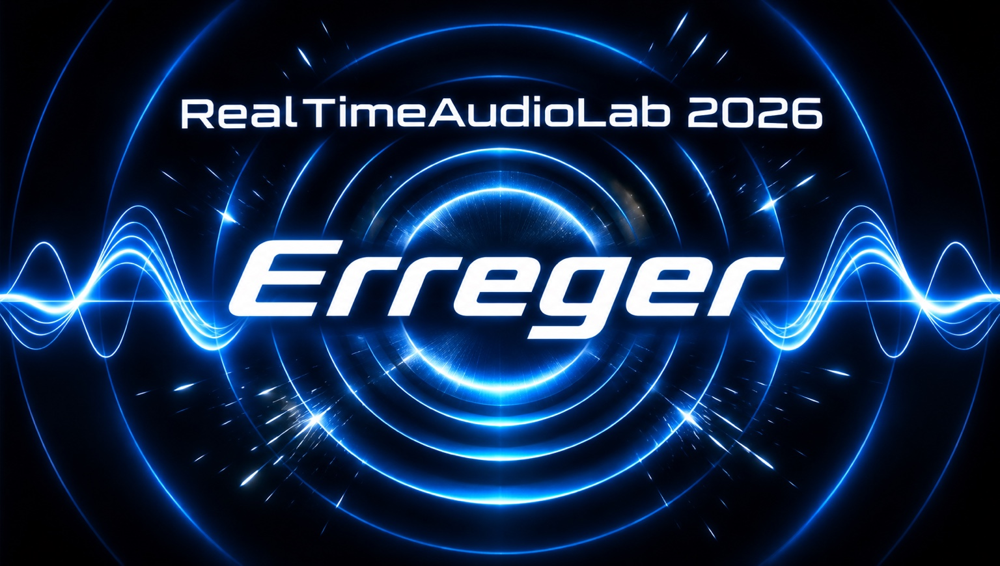
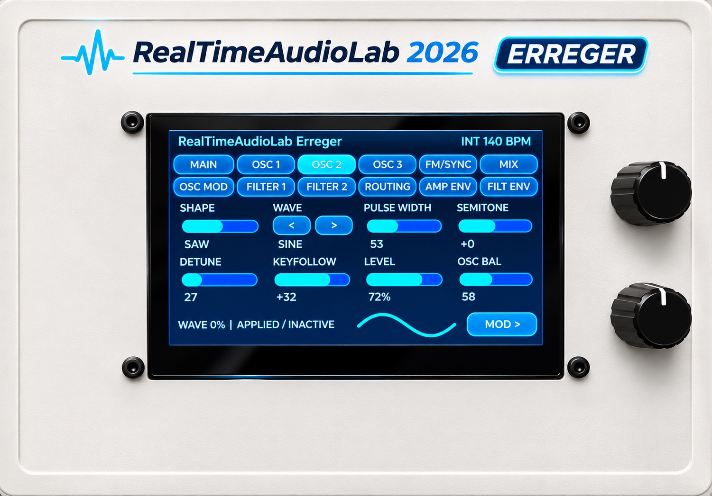
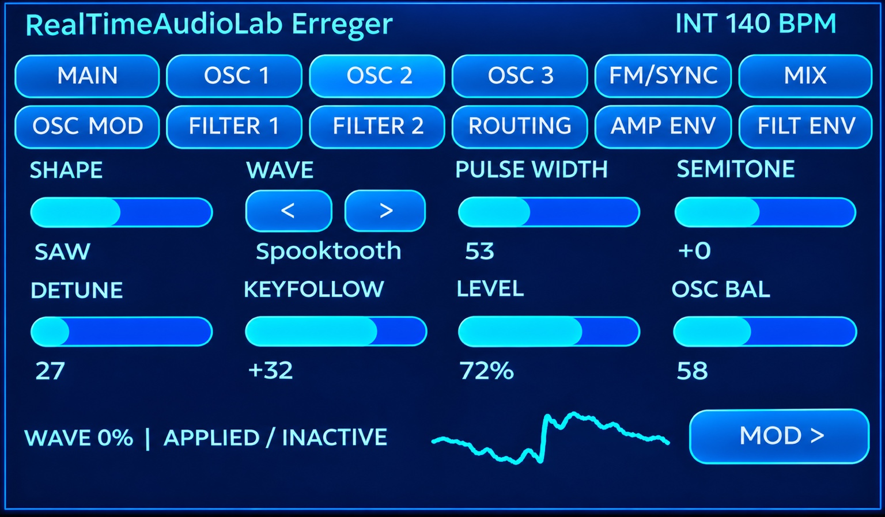
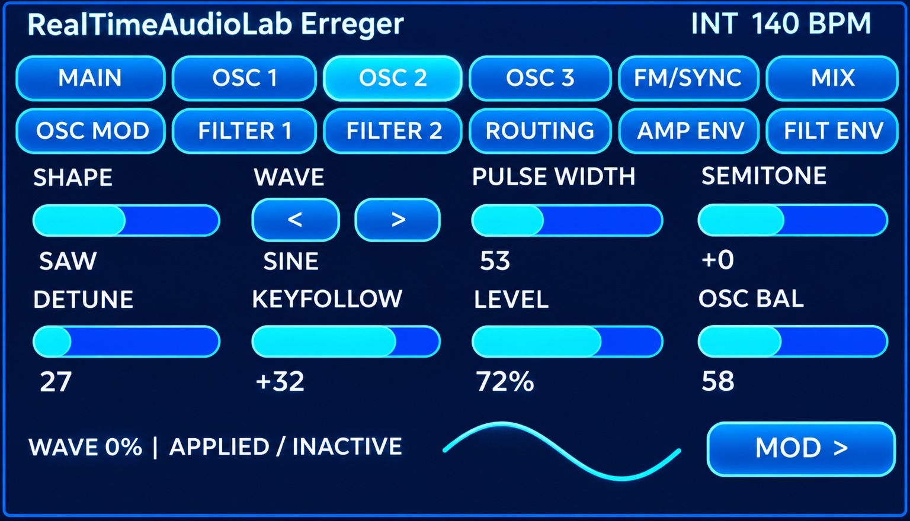
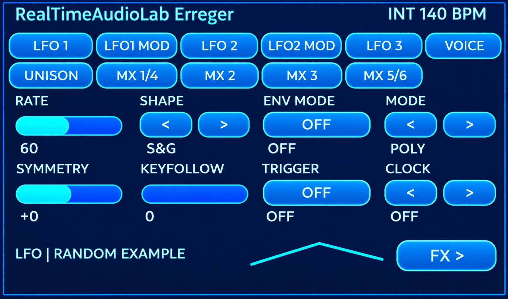
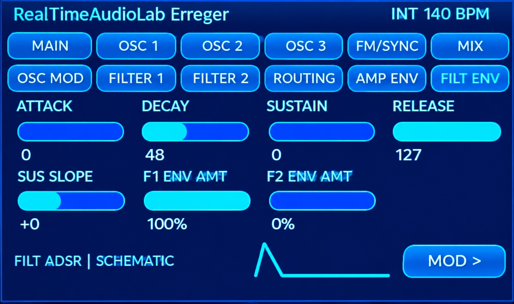
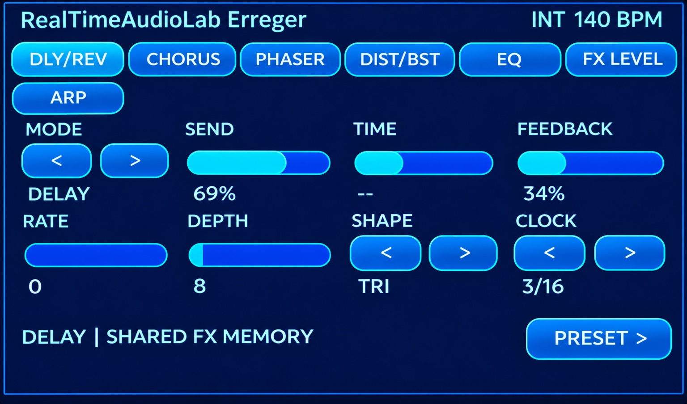
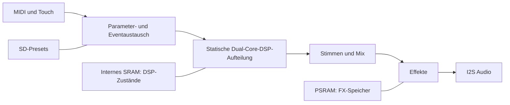

# RealTimeAudioLab Erreger

### Fortschrittlicher Virtual-Analog-, Wavetable- und FM-Synthesizer für ESP32-S3

   

**Ein eigenständiges Embedded-Instrument für lebendige Klanglandschaften, aggressive digitale Texturen, expressive Leads und komplexe Modulation.**

[English](README.md) · [Entwicklung & Architektur](docs/DEVELOPMENT.md) · [Roadmap](docs/ROADMAP.md) · [Herkunft & Lizenzen](CREDITS.md)

*Erreger-Startbild – die visuelle Identität des Instruments.*

**Gehäusevorschau**

*Gehäusevorschau – die Erreger-Touchoberfläche in einem weißen Desktop-Gehäuse. Das endgültige Gehäuse und die Belegung der physischen Regler sind noch nicht spezifiziert.*

> **Entwicklungsvorschau – November 2026.** Erreger ist eine eigenständige ESP32-S3-Portierung und Erweiterung unter Verwendung ausgewählter Code-Teile von **InfeKt-FM1 von j0kerpack**. Das Projekt ist weder die Original-Firmware für den FM-1 noch ein offizielles Access-Virus-Produkt. Klanggleichheit und Patch-Kompatibilität werden nicht zugesichert. Dieses Teaser-Paket enthält keine Firmware.

## Vom bestehenden Synthesekonzept zum eigenständigen Instrument

RealTimeAudioLab Erreger verfolgt das Ziel, eine leistungsfähige digitale Synthesearchitektur auf einer kompakten, kostengünstigen Touchscreen-Plattform verfügbar zu machen. Statt die Bedienoberfläche des FM-1 nachzubilden, entwickeln wir ein natives Instrument mit größerem Display, eigener Echtzeit-Audioarchitektur und einem erweiterbaren Sounddesign-Workflow.

Die Arbeit von j0kerpack bildet eine wichtige technische Grundlage. Die Synthesekonzepte des Originalprojekts werden ausdrücklich nicht als RTAL-Erfindungen ausgegeben. Unsere eigenständige Entwicklungsleistung liegt insbesondere in der Portierung, der Echtzeitintegration, der Touch-Oberfläche und den plattformspezifischen Erweiterungen.

## Klangarchitektur

| Bereich | Erreger-Editor / Entwicklungsumfang |
| --- | --- |
| Oszillatoren | Drei Oszillatorbereiche, Shape, Wave, Pulsbreite, Stimmung, Detune, Keyfollow, Pegel und Balance |
| FM & Sync | Eigene Bedienelemente für Frequenzmodulation und Synchronisation |
| Filter | Zwei Filterbereiche, Routing und separate Hüllkurvenanteile |
| Hüllkurven | Filter- und Amplituden-ADSR, Sustain Slope |
| Modulation | Drei LFOs, LFO-Modulationsseiten, Matrixseiten für sechs Slots, Voice/Unison |
| Effekte | Delay/Reverb, Chorus, Phaser, Distortion/Boost, EQ und FX Level |
| Performance | Arpeggiator, interne/externe Clock, MIDI und Presets |

Die Übersicht beschreibt sichtbare Editorfunktionen bzw. den Entwicklungsumfang. Sie ist keine vollständige Hardwarefreigabe sämtlicher Parameterkombinationen.

## Native Touch-GUI

Die 480 × 272 Pixel große Oberfläche im Querformat verwendet ein dunkelblaues Farbschema mit cyanfarbenen Bedienelementen. Direkte Slider, numerische Werte, Auswahltasten und grafische Vorschauen machen komplexe Klangparameter ohne PC-Editor zugänglich.

| Oszillator | LFO und Modulation |
| --- | --- |
|  |  |
| Wellenform, Stimmung und Balance | Rate, Shape, Symmetrie und Clock |
|  |  |
| Filter-ADSR und Modulationsanteile | Send, Feedback, Modulation und Clock-Teilung |

Die grafischen Kurven sind Editor-Vorschauen, keine gemessenen Oszilloskopsignale.

## Was RealTimeAudioLab erweitert hat

| Bereich | RTAL-Entwicklungsleistung | Status |
| --- | --- | --- |
| Hardware | Portierung auf ESP32-S3 / JC4827W543, Touch und I2S-Ausgabe | Basis hardwaregeprüft |
| DSP | Statische Dual-Core-Aufteilung, zeitkritische DSP-Zustände im internen SRAM, FX-Speicher im PSRAM | Basis hardwaregeprüft |
| Polyphonie | Sechs sauber spielbare Stimmen bei 32 kHz und 256 Frames | Hardwaregeprüft |
| GUI | Native Touch-Bedienung, direkte Parameter, Vorschaugrafiken, RTAL-Navigation | Basis geprüft; neuere Seiten in Validierung |
| Presets | SD-Verzeichnis `RTAL_ERREGER`, A/B-Factory-Bänke, USER-Speicher | Entwicklungsstand |
| Clock | INT/EXT-Auswahl, stabilisierte BPM-Anzeige nach Phoenix-Prinzip und triolische ARP-Teilungen | STAGE 5 implementiert, Hardwarevalidierung offen |
| MIDI | USB-MIDI Device, DIN/USB/BOTH, unabhängige Clock-Quelle, MIDI Learn, Program/Bank Select, GUI-Synchronisation und ARP HOLD | STAGE 6 implementiert, Hardwarevalidierung offen |
| MIDI-Mapping | Individuelle CC32-Seitenauswahl und CC-Zuordnung | Geplant; Zuordnung noch offen |

FM, Sync, Wavetables, Filter, LFOs, Modulationsmatrix, Effekte und Arpeggiator gehören bereits zum Synthesekonzept des Originalprojekts. Unsere Leistung besteht hier in der Anpassung und Integration für Erreger.

## Echtzeitarchitektur

*Konzeptionelle Darstellung, kein aus dem Quellcode abgeleiteter Callgraph und keine exakte Core-/Task-Zuordnung.*

### Hardwarebestätigte Referenz: STAGE 3B FIX4

| Messgröße | Berichteter Wert |
| --- | ---: |
| Abtastrate | 32.000 Hz |
| Blockgröße | 256 Frames |
| Blockfrist | 8,000 ms |
| Saubere gleichzeitige Stimmen | 6 |
| Beobachtete Audioblöcke | 10.453 |
| Deadline Misses / CPU2 Late | 0 / 0 |
| MIDI Drops / I2S Errors | 0 / 0 |
| DSP-Zustände im internen SRAM | 67.632 Byte |
| FX-Speicher im PSRAM | 147.456 Byte |
| Berichteter freier interner Heap | 77.368 Byte |

Sechs gehaltene Stimmen blieben auch beim Seitenwechsel und bei Sliderbewegungen sauber. Diese Messung bezieht sich auf die frühere hardwarebestätigte Referenz und ist keine Freigabe von STAGE 6. Die Blockfrist von 8 ms ist nicht mit der gemessenen Gesamtlatenz gleichzusetzen.

## Aktueller Entwicklungsstand: STAGE 6

- 32 GUI-Seiten, 218 GUI-Parameter und 183 eindeutige MIDI-Learn-Ziele.
- 256 Factory-Preset-Einträge in zwei Bänken; 128 USER-Slots im Speicherkonzept.
- Neun Wavetable-Assets im Entwicklungsstand; Herkunft und Weitergaberechte sind vor Veröffentlichung zu prüfen.
- Host-Tests bestanden; 256 Presets und neun Wavetables im Entwicklungscheck gerendert.
- Arduino-Kompilierung, USB-MIDI sowie umfassende GUI-/MIDI-Hardwaretests waren im letzten gemeldeten STAGE-6-Stand noch offen.

## Ausblick

Als nächster Schwerpunkt folgt die individuelle MIDI-Page-/CC-Zuordnung. Danach stehen Hardware-Regression, Preset-/Wavetable-Validierung, Performance-Messungen und eine dokumentierte Veröffentlichung im Vordergrund. Zusätzliche Stimmenoptimierung, Klangbibliotheken und Performance-Funktionen sind mögliche spätere Erweiterungen, keine verbindlichen Release-Zusagen.

[Ausführliche Roadmap](docs/ROADMAP.md)

## Hardware

| Komponente | Zielplattform |
| --- | --- |
| Mikrocontroller | ESP32-S3 Dual Core |
| Board | JC4827W543 |
| Display | 480 × 272, Querformat, GT911 Touch |
| Speicher | Zielkonfiguration 16 MB Flash, 8 MB PSRAM |
| Audio | I2S-Digitalausgabe |
| Datenspeicher | microSD |
| MIDI | DIN / natives USB-MIDI Device in Entwicklung |

## Danksagung und Lizenzen

Ein besonderer Dank geht an **j0kerpack**, den Entwickler von [InfeKt-FM1](https://j0kerpack.github.io/InfeKt-FM1/). Seine Arbeit liefert wichtige Grundlagen für dieses Projekt.

- [Original-Repository](https://github.com/j0kerpack/InfeKt-FM1)
- [Original-Credits und Lizenzhinweise](https://j0kerpack.github.io/InfeKt-FM1/downloads/CREDITS.txt)
- [Originalentwickler unterstützen](https://ko-fi.com/j0kerpack)

Die Original-Webseite kennzeichnet den Quellcode-Link mit GPL-3.0; die Credits zu Version 1.19.8 kündigen den Quellcode der eigentlichen Synthese-Engine dagegen noch an. Vor einer Firmware- oder Quellcodeveröffentlichung müssen deshalb die tatsächlich übernommenen Dateien, deren Versionen und Lizenzbedingungen überprüft werden. Für Presets und Wavetables gelten separate Herkunfts- und Rechteprüfungen. Siehe [CREDITS](CREDITS.md). Eine pauschale Lizenz für die Gesamtfirmware wird im Teaser nicht behauptet.

Erreger ist ein unabhängiges RealTimeAudioLab-Projekt ohne behauptete offizielle Verbindung zu j0kerpack, M-VAVE oder Access Music. Marken gehören ihren jeweiligen Inhabern.

**RealTimeAudioLab · 2026 — Embedded Audio Engineering & Sound Design**
