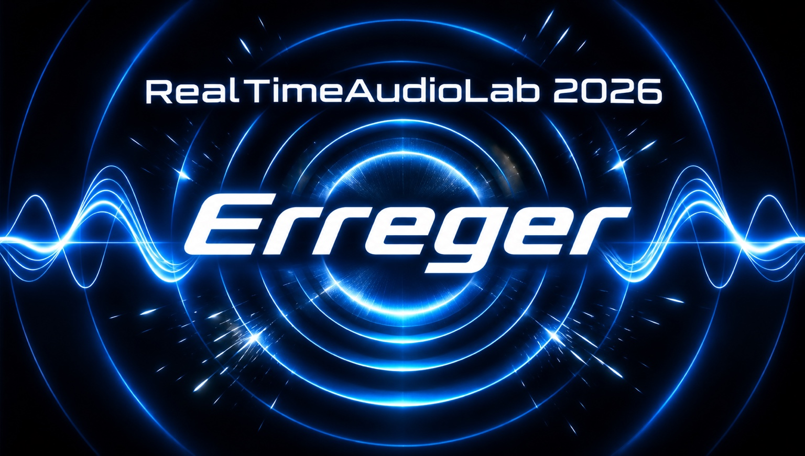
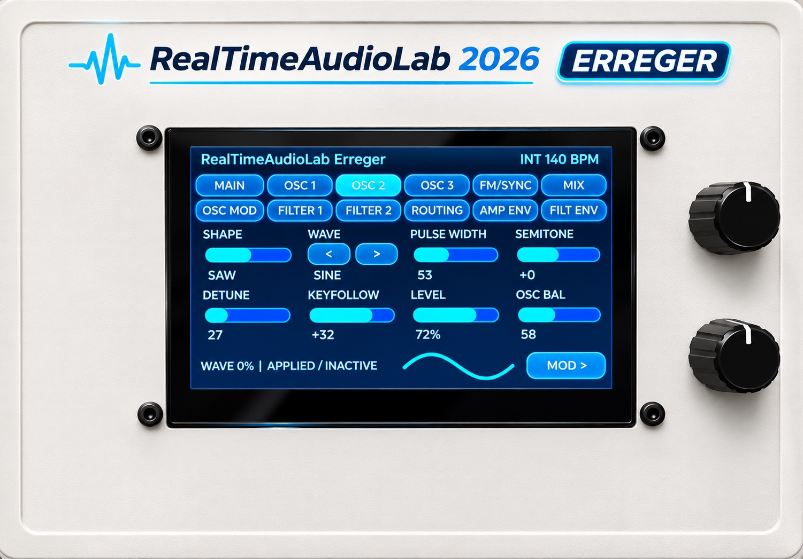

# Development and real-time architecture / Entwicklung und Echtzeitarchitektur

Snapshot: 25 November 2026. This document is a development summary based on previously reported tests and current editor images, not a fresh firmware source audit. / Entwicklungsübersicht auf Basis bisher berichteter Tests und aktueller GUI-Bilder, keine erneute Quellcodeprüfung.

## Startup artwork / Startbild

Project-supplied startup artwork; firmware integration, display timing and boot behavior are not verified by this image. / Vom Projekt bereitgestelltes Startbild; Firmwareintegration, Anzeigedauer und Bootverhalten werden durch dieses Bild nicht nachgewiesen.

## Hardware design preview / Gehäusevorschau

White desktop enclosure with integrated touchscreen and two visible rotary controls; illustration of the instrument design, not a verification of the final mechanical or electrical implementation. / Weißes Desktop-Gehäuse mit integriertem Touchscreen und zwei sichtbaren Drehreglern; Designvorschau, kein Nachweis der finalen mechanischen oder elektrischen Umsetzung.

## 1. Upstream versus RTAL

InfeKt-FM1 by j0kerpack provides the starting point for the synthesis concepts and selected reused code. The original is a separate firmware for the M-VAVE FM-1. Its public feature descriptions include complex oscillator and modulation structures, filtering, effects and performance functions. Erreger adapts parts of that work to a dedicated ESP32-S3 target. Exact file-level authorship and license lineage remain to be documented before code distribution.

InfeKt-FM1 von j0kerpack ist Ausgangspunkt für Synthesekonzepte und ausgewählte übernommene Code-Teile. Das Original ist eine eigenständige Firmware für den M-VAVE FM-1. Erreger portiert Teile dieser Arbeit auf eine andere Hardwareplattform. Eine dateigenaue Herkunfts- und Lizenzprüfung steht noch aus.

| Subsystem / Bereich | Upstream concepts / Originalkonzept | RTAL contribution / RTAL-Beitrag |
| --- | --- | --- |
| Voice engine | Oscillators, FM, sync, filters, envelopes, LFOs, modulation | Port and integration for ESP32-S3; realtime scheduling and memory adaptation |
| UI | FM-1 editor | Native landscape touch editor, navigation, direct sliders, previews |
| Platform | FM-1 hardware | JC4827W543, GT911, I2S, SD workflow |
| Runtime | Original platform implementation | Static multicore workload split; SRAM DSP state and PSRAM effects |
| Clock | Tempo synchronization exists upstream | RTAL INT/EXT UI, stabilized display and ARP clock integration |
| MIDI | MIDI and learning concepts exist upstream | RTAL DIN/USB routing, independent clock source, GUI integration, planned page mapping |
| Presets | Original banks and patch management | RTAL SD directory, bank/user-slot integration; no guarantee of binary compatibility |
| Assets | Upstream waves and patches have separate credits | RTAL asset workflow; file-level origin and rights must be audited |

## 2. Validated real-time baseline / Hardwarebestätigte Basis

STAGE 3B FIX4: 32 kHz, 256 frames, six voices. Six held notes were reported clean during page changes and slider adjustments. The observed run reported 10,453 blocks with zero deadline misses, CPU2 late events, MIDI drops and I2S errors.

STAGE 3B FIX4: sechs Stimmen bei 32 kHz und 256 Frames. Auch bei Seitenwechsel und Sliderbedienung wurde ein sauberer Klang bestätigt. Die Messung meldete bei 10.453 Audioblöcken keine Deadline-Verletzungen, CPU2-Late-Ereignisse, MIDI-Drops oder I2S-Fehler.

Block time / Blockfrist:

`T_block = 256 / 32000 s = 8 ms`

The DSP must complete the block in time for continuous output. This is a scheduling deadline, not the instrument's measured audio or MIDI-to-audio latency. The observed block count represents approximately 83.6 seconds of audio if all blocks were contiguous. No peak/average DSP time or measured end-to-end latency is available in this summary; no CPU utilization claim is made.

Die DSP-Berechnung muss rechtzeitig für die kontinuierliche Ausgabe abgeschlossen sein. 8 ms sind keine gemessene MIDI-zu-Audio- oder Gesamtlatenz. 10.453 aufeinanderfolgende Blöcke entsprächen ca. 83,6 Sekunden Audio. Ohne gemeldete maximale oder mittlere DSP-Zeit wird keine CPU-Auslastung angegeben.

| Memory / Speicher | Reported bytes / gemeldete Byte | Approx. KiB |
| --- | ---: | ---: |
| Internal DSP state / interne DSP-Zustände | 67,632 | 66.0 |
| PSRAM FX | 147,456 | 144.0 |
| Remaining internal heap / freier interner Heap | 77,368 | 75.6 |

The design keeps latency-sensitive DSP state in internal SRAM while using external PSRAM for larger effect memory. The static work split is intended to reduce unpredictable contention. Exact per-core responsibilities, synchronization primitives and buffer ownership should be documented from the firmware source in a later architecture audit.

## 3. Development snapshots / Entwicklungsstände

| Stage | Reported development state | Validation |
| --- | --- | --- |
| 3B FIX4 | Static multicore runtime, six voices, SRAM/PSRAM allocation | Hardware confirmed |
| 5 | 31 pages, 209 controls, 256 factory preset entries, 128 user slots, nine wavetables, INT/EXT, smoothed tempo, triplet ARP clock | Development implementation; do not infer full hardware qualification |
| 6 | 32 pages, 218 controls, 183 distinct MIDI Learn targets; USB-MIDI device, DIN/USB/BOTH, independent clock, MIDI Learn, PC/bank selection, bidirectional UI, ARP HOLD | Host checks passed; latest reported Arduino and hardware qualification pending |
| Next | Custom MIDI CC32 page architecture and user-defined parameter assignments | Pending mapping and implementation |

The STAGE 5 clock display design was reported to use a 24-interval history, IIR factor 0.05, 0.75 BPM display hysteresis and a 600 ms timeout. These are reported implementation settings, not externally measured jitter or synchronization accuracy. The display smoothing should not be confused with the scheduler's actual clock timing.

Die BPM-Anzeige von STAGE 5 nutzt laut Entwicklungsstand 24 Zeitintervalle, IIR-Faktor 0,05, 0,75 BPM Anzeigehysterese und 600 ms Timeout. Dies sind berichtete Implementierungswerte, keine extern gemessenen Jitterwerte. Die Anzeigeglättung ist nicht mit dem eigentlichen Clock-Scheduling gleichzusetzen.

## 4. Sound design and test scope / Klanggestaltung und Testumfang

The five GUI images show distinct oscillator, modulation, delay and filter-envelope views. The sine and Spooktooth screenshots illustrate waveform selection. Their footer reads WAVE 0% / APPLIED / INACTIVE, so the selected preview alone does not prove that the waveform contributes to the current sound. The delay screenshot shows a 3/16 clock division; the filter view shows schematic ADSR rather than measured voltage or audio.

Die fünf GUI-Bilder dokumentieren unterschiedliche Ansichten. Die ausgewählte Wellenform ist nicht automatisch im Audiosignal aktiv: In beiden Oszillator-Ansichten steht WAVE 0% / APPLIED / INACTIVE. Die Kurven dienen der Editor-Vorschau. Die Delay-Ansicht zeigt eine 3/16-Clock-Teilung.

## 5. Engineering direction / Technische Entwicklungsrichtung

- Keep the six-voice baseline as the regression reference; benchmark more complex FM, modulation, unison and effects combinations before raising polyphony.
- Preserve bounded audio-block execution, keep SD and display work from blocking realtime DSP, and measure peak DSP time and deadline failures.
- Verify MIDI event delivery and transport independently of the BPM display; test DIN, USB and BOTH, source switching and clock loss.
- Validate preset round trips, SD error paths, waveform selection and actual audible contribution. Record exact asset lineage and license.
- Document hardware configuration, build version, dependency versions, test logs and the applicable license for each reused component.

Further detailed mathematical or algorithmic descriptions require the matching firmware source revision; they are intentionally not invented here.

Weitere mathematische und algorithmische Details setzen den passenden Firmware-Quellstand voraus und werden hier bewusst nicht erfunden.
