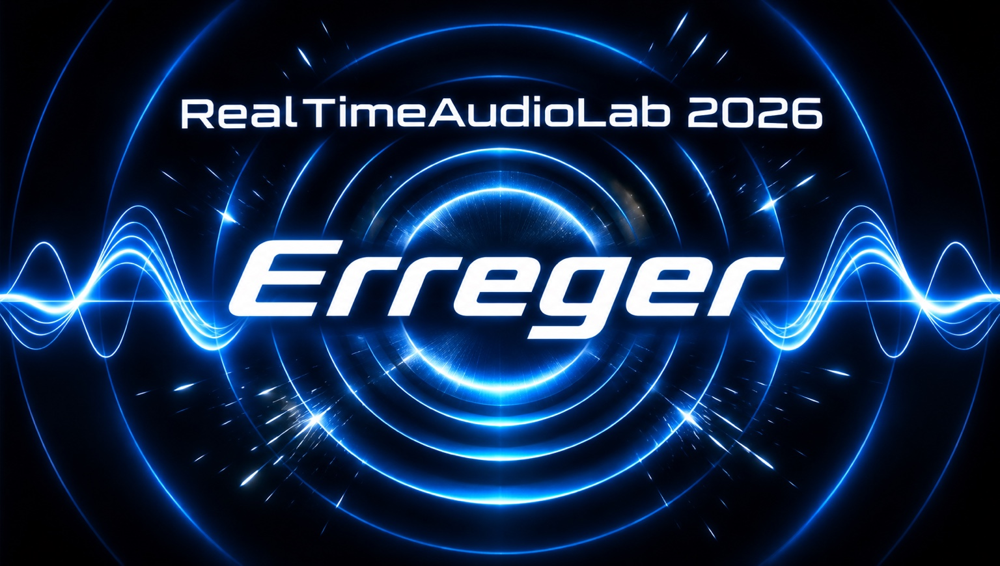

# Roadmap / Entwicklungsplanung

Development preview, 25 November 2026. Priorities below distinguish the agreed next work from suggested later improvements; no dates or release guarantees.

| Priority | Work package / Arbeitspaket | Status | Acceptance criteria / Abnahme |
| --- | --- | --- | --- |
| P0 | STAGE 6 hardware qualification / Hardwarevalidierung | Open | Arduino build; six voices; DIN/USB/BOTH; GUI sync; clock source switching; no audio failures in regression test |
| P0 | Custom MIDI page and CC mapping / Individuelles MIDI-Mapping | Agreed next design | User fills mapping for 183 distinct targets; define CC32 page behavior and resolve conflict with existing bank selection; validate duplicate CCs and persistence requirements |
| P0 | Source and asset audit / Quellcode- und Rechteprüfung | Required before distribution | Record upstream revision, file names, authors, changes and license; verify permission to redistribute presets and waves |
| P1 | SD preset workflow / SD-Preset-Verwaltung | In development | A/B factory and USER slot round trips, restart persistence, missing/corrupt file handling, no audio deadline misses during operations |
| P1 | Waveform and sound engine verification / Wavetable- und Klangprüfung | Proposed qualification | Confirm waveform loading, audible selection, tuning, FM/sync, filters, mod matrix and effect parameter behavior |
| P1 | Timing and arpeggiator tests / Clock- und ARP-Tests | Proposed qualification | Internal/external sync, triplets, clock loss, hold, transport, no dropped MIDI events |
| P1 | Performance measurement / Performance-Messungen | Proposed qualification | Peak/average block time, deadline misses, memory usage, sustained polyphony under demanding patches, separate latency measurement |
| P2 | Sound library / Klangbibliothek | Proposed expansion | Curated original or redistribution-cleared patches, diverse basses, leads, pads, evolving textures and FX sounds; audio examples |
| P2 | Further polyphony and DSP optimization / Weitere Stimmen- und DSP-Optimierung | Proposed research | Maintain sound quality, control responsiveness and zero-deadline-miss baseline before claiming additional voices |
| P2 | Expanded performance features / Weitere Performance-Funktionen | Exploratory | Evaluate musical benefit and realtime budget; no commitment to sequencer, layering or split modes in this preview |
| Release | Documentation and release package / Dokumentation und Release | Future milestone | Verified build and hardware instructions, parameter/MIDI reference, test evidence, source notices and required license material |

## Visual identity and hardware design / Startbild und Gehäusereferenz

Startup artwork is available; implementation and boot validation remain to be confirmed. / Das Startbild liegt vor; Firmwareintegration und Bootvalidierung sind noch zu bestätigen.

[Enclosure preview / Gehäusevorschau](../images/erreger-enclosure.jpg) — visual reference only; final construction and physical control assignments remain unspecified. / Visuelle Referenz; endgültige Konstruktion und Reglerbelegung sind noch nicht spezifiziert.

## Next step / Nächster Schritt

The custom MIDI table is the immediate design task: 183 distinct destinations, 218 GUI parameters and 32 pages were reported in STAGE 6. CC32 is intended to select pages in the custom mapping, but its existing Bank Select role needs an explicit resolution before implementation. Final controller assignments are supplied by the user, not preassigned in this teaser.

Die eigene MIDI-Tabelle ist der nächste konkrete Design-Schritt: 183 eindeutige Ziele, 218 GUI-Parameter und 32 Seiten. CC32 soll in der individuellen Architektur zur Seitenauswahl dienen; die bisherige Bank-Select-Funktion muss dabei ausdrücklich geklärt werden. Die endgültigen Controller-Zuordnungen werden vom Anwender festgelegt.

## Scope exclusions / Abgrenzung

This teaser does not promise exact Access Virus compatibility, all InfeKt-FM1 features, 16-voice operation, a sequencer or a release date. Features of the upstream project should not be assumed available on the RTAL target without individual verification.

Der Teaser verspricht weder vollständige Access-Virus-Kompatibilität noch alle Funktionen des Originalprojekts, 16 Stimmen, einen Sequencer oder einen Veröffentlichungstermin. Die Funktionen des Originals müssen auf der RTAL-Hardware einzeln überprüft werden.
